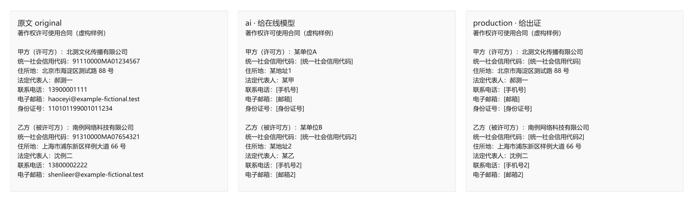

[简体中文](README.md) | [English](README.en.md)

# legal-redactor

[](https://github.com/qwertyzhu/legal-redactor/actions/workflows/ci.yml)
[](LICENSE)
[](pyproject.toml)

**中国法律文书本地脱敏助手：交在线 AI 之前激进去标识，交法院 / 对方之前只去掉证件号、手机、邮箱。**  
**Local-first dual-mode redaction for Chinese legal documents.**  
Hide Party A, Party B, or both on request (names, contact details, signatures, the complete seal). Entity detection can use a **local Ollama model** so the original text is not sent to an online model.  
Same format out as in: DOCX→DOCX, PDF→PDF (text-layer), text→text. Writes a local audit ledger and runs a residual check.  
Built for lawyers who need (1) a privacy-safe copy before pasting into online AI, and (2) a selective production copy before court or opponent disclosure.

> Early preview. Does not replace lawyer judgment. A passing residual scan is not proof of perfect anonymization.

## Two modes

| Mode | Destination | Default behavior |
|---|---|---|
| `ai` | Online models, shareable notes | Aggressive de-identification, including court-staff names |
| `production` | Court / opposing party | Keep parties and case numbers; strip IDs, phones, emails, bank accounts, USCC |
| `publish` | Public write-up | Every natural person becomes 张某; addresses stop at district; amounts are fuzzed. Not a court-publication copy |
| `judgment-online` | Judgment publication under SPC Interpretation No. 19 [2016] | Keep parties, birth dates, case numbers, USCC, counsel and court staff; truncate labelled addresses to district; only entities with `role=article8` become 张某 |

High-confidence names and organizations are caught by `--auto-confident`. Add `entities.json` only for what that pass misses.

Skill text: [skills/legal-document-redactor/SKILL.md](skills/legal-document-redactor/SKILL.md). Share `https://github.com/qwertyzhu/legal-redactor/blob/main/skills/legal-document-redactor/SKILL.md`.

### Hide Party A, Party B, or both

For scanned contracts, the user can choose to hide Party A only, Party B only, or both parties. Whole-party mode covers confirmed names, contacts, addresses, contact details, and accounts, plus reviewed regions for signatures and the **complete seal**. An unselected party is preserved by default.

```console
legal-redactor redact-scan scan.pdf --mode production \
  --redact-party a --party-spec party-spec.json \
  -o scan.party-a-redacted.pdf
```

Start from `skills/legal-document-redactor/references/party-redaction.template.json`. A seal must be covered by a reviewed normalized region containing its full outer ring, entity name, number, and center mark; OCR text boxes alone are insufficient. Review every output page before delivery.

### Selective redaction (v0.10.3+)

No need to adopt a whole mode: reverse-enumerate `--keep-categories` to strip one structural category only, name specific persons via `entities.json`, or `--preserve` passages verbatim. Decision table in the skill's `SKILL.md`.

### Optional local Ollama model for entity detection (v0.10.4+)

The tool always runs on your machine. Entity detection can use a **local Ollama model** instead of the online agent, so the original text is not sent to an online model; replacement stays deterministic via the CLI (the model only finds, never rewrites):

```console
python3 skills/legal-document-redactor/scripts/ollama_setup.py      # read-only check; recommends a model by device RAM
python3 skills/legal-document-redactor/scripts/ollama_entities.py INPUT.docx -o entities.draft.json
legal-redactor redact INPUT.docx --mode ai --entities entities.draft.json -o OUTPUT.docx
```

A plain text model (default qwen3.5) is enough for detection; OCR stays with Tesseract, and vision models are only an optional OCR-quality booster. See "operating rules for local Ollama" in the skill.

### Norm baselines and templates (v0.10.3+)

- `references/redaction-standards.md`: maps PRC judgment-publication rules, PIPL, GB/T 37964-2019, and bar-association AI guidance onto tool parameters, incl. known detector blind spots
- `references/entities.court-style.template.json`: court-publication-style aliases (surname + 某, district-level addresses, fuzzed amounts)

## 60-second start

```console
git clone https://github.com/qwertyzhu/legal-redactor.git
cd legal-redactor
python -m pip install -e ".[dev]"
legal-redactor --version
python scripts/run_demo.py --clean
```

`run_demo.py` redacts the in-repo fictional contract in **both** modes and writes same-format `md` / `docx` / `pdf` under `demo-output/`. It must print that every residual scan passed. Re-run with `--clean` any time; the result is deterministic.

### Web UI & Standalone HTML Modes

#### Option 1: Standalone Pure HTML (Recommended, Zero Backend)
Simply open `legal-redactor.html` (or `docs/index.html` / GitHub Pages) in any browser:
- **Zero-Backend**: 100% in-browser memory execution; document contents never leave your machine.
- **Client-side PDF & Word Redaction**: Redacts PDF (via pdf-lib / pdf.js text masking) and DOCX (via JSZip XML reconstruction) without Python or any server.
- **Interactive AI Prompt Box**: Input specific redaction requirements directly in natural language (e.g. "Only redact phone numbers and amounts", "Mask all party names"), supporting local Ollama (`http://localhost:11434`) or custom OpenAI API.
- **Designed by**: lawyer朱思浩

#### Option 2: Local Python Web Server (`legal-redactor web`)
```console
legal-redactor web
```
- Opens `http://127.0.0.1:8765`, 100% local operation with zero network requests.
- Full server capabilities including Tesseract OCR for scanned PDF pages and OpenCV seal detection.
- One-click downloads for redacted documents, audit reports (`.audit.md`), and ledger mappings (`.ledger.json`).

## Fictional before / after

The sample party is **郝测一** and the sample mobile is **13900001111** (fully fictional).

| Field | Original | `ai` | `production` |
|---|---|---|---|
| Party name | 郝测一 | removed (alias `某甲`) | **kept** |
| Mobile | 13900001111 | removed | removed |
| Case number | （2024）京0491民初1234号 | removed | **kept** |



```text
# original (excerpt)
法定代表人：郝测一
联系电话：13900001111
关联案号示例：（2024）京0491民初1234号

# after --mode ai
法定代表人：某甲
联系电话：[手机号]
关联案号示例：（20XX）XX民初XX号

# after --mode production
法定代表人：郝测一
联系电话：[手机号]
关联案号示例：（2024）京0491民初1234号
```

Never use `ai` output as a court filing. Never upload `*.ledger.json`.

## Install

From a clone (documented path; PyPI is not published yet):

```console
python -m pip install -e ".[dev]"
legal-redactor --help    # lists redact / scan / verify
```

CLI-only from the **latest** GitHub Release wheel (v0.14.2 shown; check [Releases](https://github.com/qwertyzhu/legal-redactor/releases/latest) first):

```console
python -m pip install https://github.com/qwertyzhu/legal-redactor/releases/download/v0.14.2/legal_redactor-0.14.2-py3-none-any.whl
```

**Upgrade rule**: update the skill bundle and the Python package together. CHANGELOG entries marked "skill only" need no wheel upgrade; entries marked "fix (package)" (e.g. v0.10.7 fixing label-adjacent email misses) **require** the new wheel. After installing, run the self-check:

```console
python3 ~/.claude/skills/legal-document-redactor/scripts/self_test.py   # all PASS = ready
```

### Claude Code / Codex skill

Copy or junction `skills/legal-document-redactor` into `~/.claude/skills/` (or `~/.agents/skills/`).  
Release assets also include a packed `legal-document-redactor.skill` plus `SHA256SUMS.txt`.  
For Skillhub, upload `legal-document-redactor-skillhub.zip` (`SKILL.md` is at the zip root). Do not upload the repository zip or the `.skill` file.

Codex:

```text
$skill-installer
Install skill from qwertyzhu/legal-redactor:
- skills/legal-document-redactor
```

## CLI

```console
# Scan only
legal-redactor scan contract.docx --mode ai

# Redact for online AI (entities JSON optional but recommended for names)
legal-redactor redact contract.docx --mode ai --entities entities.json -o contract.redacted-ai.docx

# Redact for court/opponent production
legal-redactor redact contract.docx --mode production --entities entities.json -o contract.redacted-production.docx

# Keep USCC on a filing that requires it
legal-redactor redact contract.docx --mode production --keep-categories uscc -o out.docx
legal-redactor verify out.docx --mode production --keep-categories uscc

# Scanned PDF (no text layer)
legal-redactor ocr scan.pdf -o workdir/
legal-redactor redact workdir/ocr.normalized.md --mode production -o workdir/out.md
legal-redactor redact-scan scan.pdf --mode production -o scan.redacted-production.pdf

# Residual check
legal-redactor verify contract.redacted-ai.docx --mode ai

# Draft entities skeleton (structural + NL suspect hints)
legal-redactor draft-entities contract.docx -o entities.draft.json

# Batch a folder of documents (two-pass: unify aliases then redact)
legal-redactor redact ./matters/ --mode ai --unify -o ./matters-redacted/

# Or unify manually, then reuse the file
legal-redactor unify ./matters/ -o ./matter-unified/ --mode ai
legal-redactor redact ./matters/ --mode ai --entities ./matter-unified/entities.consistent.json -o ./matters-redacted/

# Directory scan / residual verify
legal-redactor scan ./matters/ --mode ai
legal-redactor verify ./matters-redacted/ --mode ai
```

Each successful `redact` also writes:

- `*.ledger.json` — original→replacement map (**keep local; never commit or upload**). Since v0.11 it defaults to `~/.legal-redactor/ledgers/<hash>/` (0600) with a `*.ledger-path.txt` pointer beside the output; `--ledger-encrypt` and `legal-redactor restore` are available
- `*.audit.json` / `*.audit.md` — per-replacement audit and residual risks (contains context; local only)
- `*.residual.json` — structural residual report
- `*.suspects.json` — natural-language entity **hints** (not auto-redacted)
- `*.summary.md` — human-readable table

Batch also writes `entities.consistent.json` + `consistency.report.*` under the work dir.

Scanned workflow: `skills/legal-document-redactor/references/scanned-pdf.md`.  
Entity starter: `skills/legal-document-redactor/references/entities.template.json`.  
Optional structural + suspect draft: `legal-redactor draft-entities INPUT.docx`.

## Tests

```console
python -m pytest
python scripts/run_demo.py --clean

# Skill install self-check (run once on a new device / after upgrades; all PASS = ready):
python3 skills/legal-document-redactor/scripts/self_test.py
```

Demo inputs are completely fictional. Any resemblance to real parties is coincidental.

## Architecture

```text
Document → extract text → merge structural detectors + entities.json
        → longest-first replace → write same format
        → residual structural scan → human review
```

Details: [skills/legal-document-redactor/references/methodology.md](skills/legal-document-redactor/references/methodology.md)

## Limitations

- PDF: text-layer via `redact`; scans via `ocr` / `redact-scan` (local Tesseract + chi_sim)
- `redact-scan` is OCR-box best-effort — **human page-flip before court filing**
- Whole-party redaction depends on confirmed `party-spec` identifiers and reviewed regions; an omitted name, signature, or seal region can remain visible
- A seal cannot rely on OCR text boxes alone: cover its complete outer ring, entity name, number, and center mark, then review every page
- An unselected party is preserved by default; only `--also-redact-structural-all` additionally covers structural identifiers for every party
- High-confidence names are applied by `--auto-confident`; unconfirmed suspects stay in the sidecar until written into `entities.json`
- Multi-doc AI upload: prefer `redact DIR --unify` so aliases stay stable
- DOCX: entities split across runs are replaced in place, keeping every other run's formatting; only an entity crossing a tab/line break/tracked-change boundary collapses the paragraph
- Natural-language names are rule-based (role words, relation words, company suffixes); unanchored names and app/product names can still slip through. In `ai` mode, `verify` lists name/org/address candidates left in the output as WARN — use `--strict` before delivery
- Batch redact is flat output names (recursive mode disambiguates colliding basenames)
- Directory `verify` will scan all supported suffixes present (including `.json` sidecars if mixed in)
- Not legal advice; not a substitute for firm confidentiality procedure

## Security

Do not open issues with real client files, ledgers, or live matter identifiers. See [SECURITY.md](SECURITY.md).

## License

Apache License 2.0. See [LICENSE](LICENSE) and [NOTICE](NOTICE).
